# LeatherGuard AI

**Automated leather defect detection for automotive interiors** — a full-stack computer-vision system that inspects cut leather pieces, decides whether each one is conforming (IO) or non-conforming (NIO), identifies the defect type, and explains every rejection with a SHAP heat map.

Built during my final-year engineering internship at **DRÄXLMAIER UATS Sousse** (armrests for BMW and Land Rover), for the National Engineering Degree in Computer Science at ENSIT, Tunisia (2025–2026).


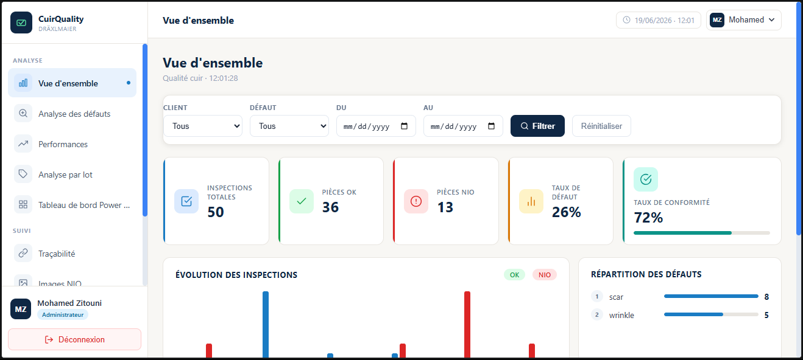

---

## The problem

Leather is a natural material: scars, wrinkles and tick marks are part of the hide. On the production line, cut pieces were checked by eye under 1,800 lux lighting — tiring, subjective, and with no record of *why* a piece was rejected.

A defect caught on a **cut piece costs €5–15**. The same defect found on a **finished armrest costs €130–315**. Detecting it earlier, consistently, and with full traceability was the goal.

## What it does

- **Identifies the customer** (BMW or Land Rover) from the image, since each has its own quality standard
- **Classifies each piece IO / NIO** using anomaly detection trained on good pieces only
- **Identifies the defect type** (scar or wrinkle) on rejected pieces
- **Explains each rejection** with a SHAP map showing which regions drove the decision
- **Records every inspection** (image, result, confidence, defect, operator, lot) for full traceability
- **Shows quality KPIs** in near real time to quality and continuous-improvement managers

---

## AI pipeline

Three specialised models run in sequence, each answering one question:

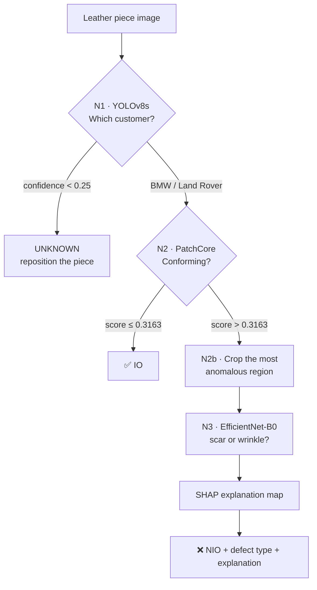

| Level | Task | Model | Why this model |
|---|---|---|---|
| **N1** | Customer identification | YOLOv8s (transfer learning) | Best capacity/generalisation trade-off for a small dataset |
| **N2** | IO / NIO classification | PatchCore (wide_resnet50_2 + FAISS k-NN) | Learns from conforming pieces only — defective pieces are rare (10–30 per day) |
| **N3** | Defect type | EfficientNet-B0 (progressive fine-tuning) | Defects are diffuse textures, not objects; a classifier on the crop beats a detector |
| **XAI** | Explanation | SHAP (occlusion, 225 patches) | Lets quality engineers check and justify each rejection |

### Results

| Model | Metric | Result |
|---|---|---|
| N1 · YOLOv8s | mAP50 / precision / recall | **99.5%** / >99% / >99% |
| N2 · PatchCore | F1 (NIO) / recall (NIO) / precision (NIO) | **87.3%** / 88.6% / 86.1% |
| N2 · PatchCore | AUROC / accuracy | 0.741 / 82% |
| N3 · EfficientNet-B0 | Accuracy / AUC-ROC | **91.9%** / 0.965 |

An iterative approach got there: YOLOv8s was first tried for defect detection and reached only 0.7% → 12.8% mAP50, because leather defects have no sharp boundaries and labelled examples were scarce. Switching to unsupervised anomaly detection (N2) and crop classification (N3) solved it.

<table>
  <tr>
    <td>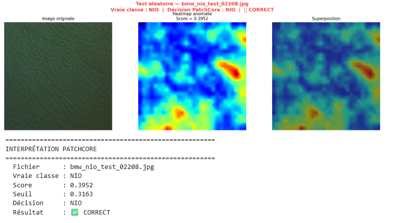</td>
    <td>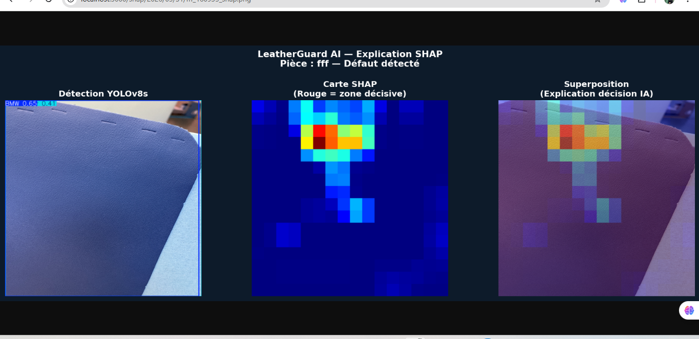</td>
  </tr>
  <tr>
    <td align="center"><sub>PatchCore anomaly heat map on a NIO piece</sub></td>
    <td align="center"><sub>SHAP map: red regions drove the rejection</sub></td>
  </tr>
</table>

### Dataset

No image dataset existed when the project started; it was built from scratch on the inspection table.

- Captured under standardised 1,800 lux lighting — first with an iPhone 13 Pro, then with a fixed IDS industrial camera for reproducible images
- Annotated by hand in Label Studio (YOLO format; oriented boxes for wrinkles converted to axis-aligned boxes)
- Offline augmentation ×4 (rotation, flips, brightness, Gaussian noise, zoom)
- 611 images for customer identification, 3,252 for IO/NIO, 1,221 for defect classification

> The dataset and trained weights belong to DRÄXLMAIER and are **not included** in this repository.

---

## System architecture

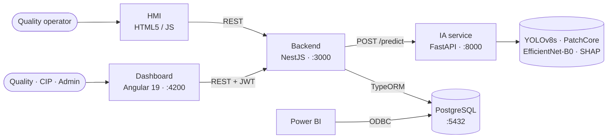

A **hybrid modular architecture**: a NestJS modular monolith handles business logic, authentication and data access, while a Python micro-service runs the models (YOLOv8, PatchCore and SHAP live in the Python ecosystem). Everything runs **on-premise**, with no cloud dependency, to protect industrial data.

### Inspection flow

1. The operator logs in with their badge number, scans the lot, then the big hide
2. They enter the ID of a cut piece — the analysis starts automatically
3. NestJS saves and resizes the image (640×640) and calls the IA service
4. The IA service runs N1 → N2 → N2b → N3 → SHAP and returns JSON
5. NestJS stores the inspection (and the defect if NIO) in PostgreSQL
6. The HMI shows the verdict: green (IO), red (NIO) or orange (UNKNOWN)

---

## Screenshots

| Operator HMI — NIO result | Inspection report with SHAP map |
|---|---|
| 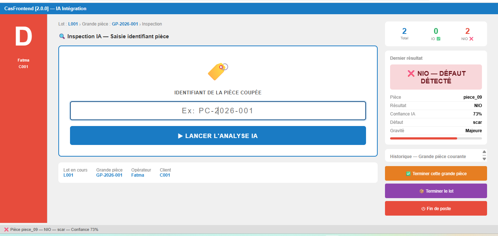 | 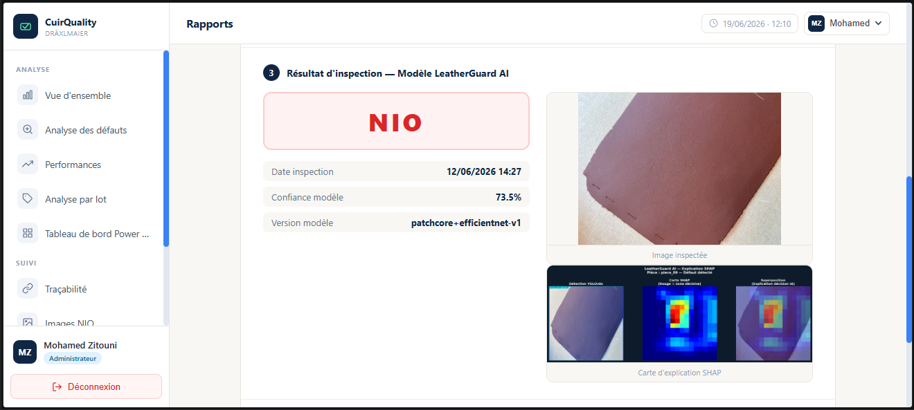 |
| **NIO image gallery** | **Traceability search** |
| 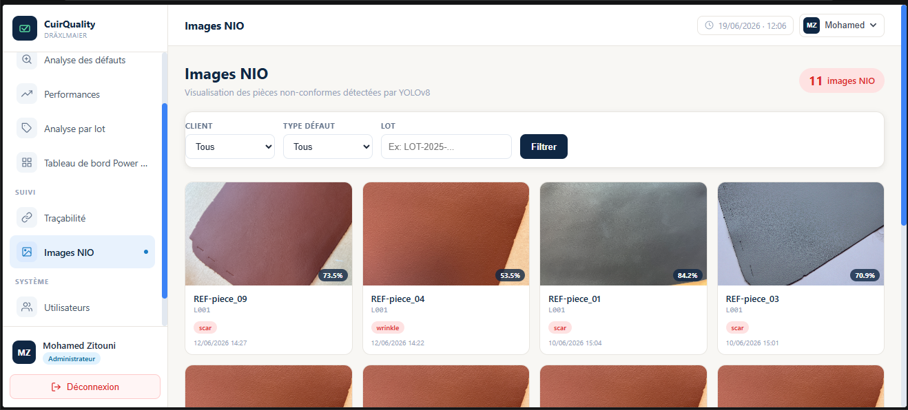 | 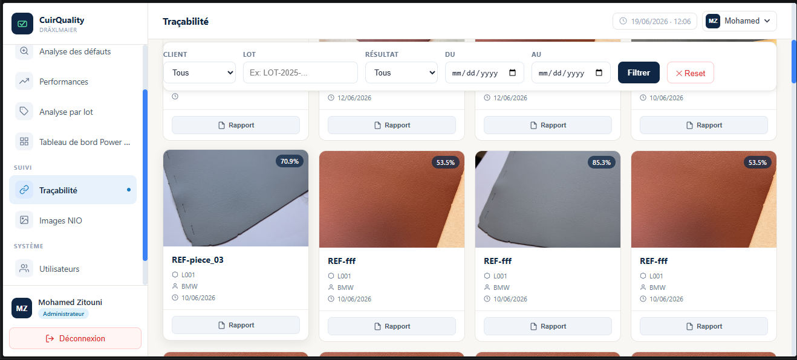 |
| **Dashboard login (JWT)** | **Power BI analytics** |
| 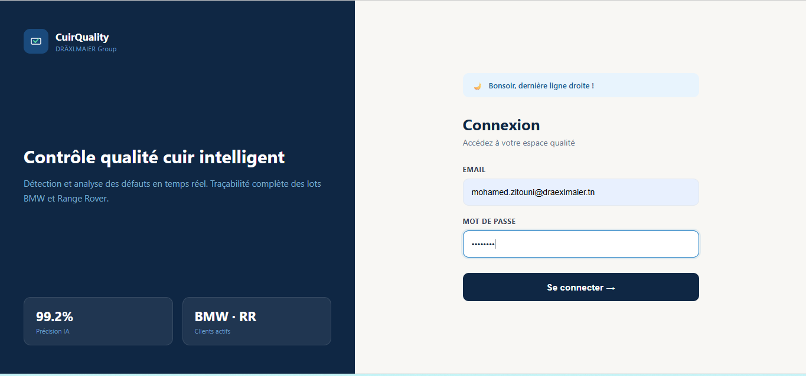 | 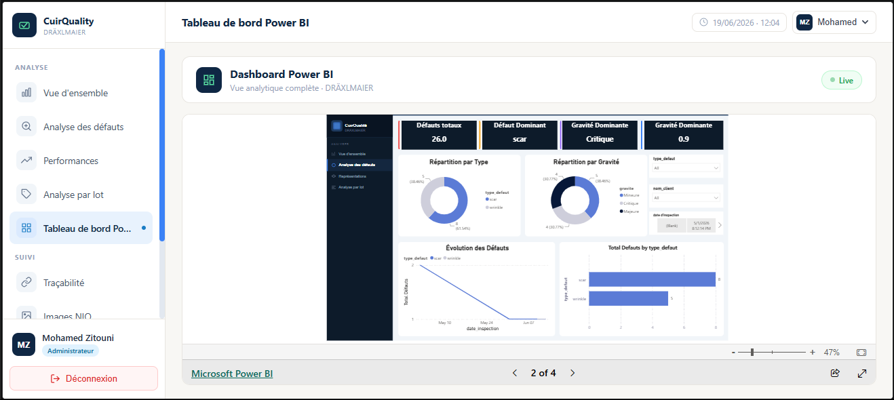 |

---

## Repository structure

```
leatherguard-ai/
├── backend/      NestJS API — auth (JWT), users, lots, HMI flow, dashboard KPIs, PDF/e-mail reports
├── dashboard/    Angular 19 SPA — KPIs, defect analysis, performance, lots, traceability, NIO gallery, reports, admin
├── hmi/          Operator interface (HTML5 / JavaScript) for the inspection station
├── ia-service/   FastAPI service — 3-level pipeline and SHAP explainer
└── docs/         Screenshots and diagrams
```

## Tech stack

| Layer | Technologies |
|---|---|
| AI / Computer vision | PyTorch, Ultralytics YOLOv8, PatchCore, timm (EfficientNet-B0), FAISS, SHAP, OpenCV |
| IA service | Python 3.10, FastAPI, Uvicorn |
| Backend | NestJS 11, TypeScript, TypeORM, Passport-JWT, bcrypt, Swagger, Sharp, Nodemailer |
| Frontend | Angular 19 (guards, JWT interceptor), HTML5 / JavaScript for the HMI |
| Data | PostgreSQL 18 (10 tables), Power BI via ODBC |
| Tooling | Label Studio, Kaggle (Tesla T4 GPU), Postman, pgAdmin, Git |
| Method | Scrum (3 releases, 8 sprints) + CRISP-DM for the data-science work |

---

## Running locally

**Prerequisites:** Node.js 20+, Python 3.10, PostgreSQL, and the trained model weights (not included — see [`ia-service/models/README.md`](ia-service/models/README.md)).

**1. Database**

Create a PostgreSQL database (e.g. `leatherguard`) with the project schema (`client`, `lot`, `grande_piece`, `piece`, `inspection`, `defaut`, `operateur`, `session_operateur`, `users`, `app_user`).

**2. IA service** — port 8000

```bash
cd ia-service
python -m venv .venv
.venv\Scripts\activate          # Windows  (Linux/macOS: source .venv/bin/activate)
pip install -r requirements.txt
uvicorn predictapi:app --port 8000
```

**3. Backend** — port 3000, Swagger docs at `http://localhost:3000/api`

```bash
cd backend
cp .env.example .env            # then fill in your values
npm install
npm run start:dev
```

Static folders for inspection images and SHAP maps are configured in `backend/src/main.ts`.

**4. Dashboard** — port 4200

```bash
cd dashboard
npm install
npm start
```

**5. HMI** — open `hmi/index.html` in a browser on the inspection station.

---

## Future work

- Trigger capture automatically from the IDS camera instead of entering piece IDs by hand
- Add more defect classes (open areas, tick marks, stains, holes) as the dataset grows
- Continuous learning: retrain from inspections validated by quality engineers

## Author

**Ines Abdellaoui** — Computer Engineering (New Technologies & Security), ENSIT

Supervised by Mme Ines Elouedi (ENSIT) and M. Mohamed Zitouni (DRÄXLMAIER UATS).

*This is an academic project carried out at DRÄXLMAIER UATS. The industrial dataset and trained models are not published.*
